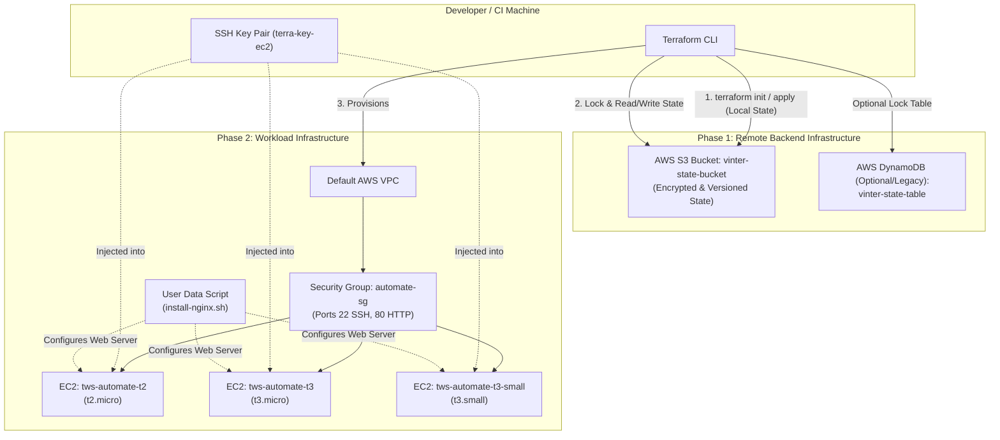

# Mastering Terraform Remote State: S3 Backend, State Locking & Multi-Instance EC2 Automation

> A comprehensive, hands-on educational guide to transitioning from fragile local state files to enterprise-grade remote state management on AWS with Terraform, S3, State Locking, and automated EC2 multi-instance deployments.

---

## 📑 Table of Contents

- [1. Introduction: Why Do We Need Remote Backends?](#1-introduction-why-do-we-need-remote-backends)
  - [The Dangers of Local State](#the-dangers-of-local-state)
  - [What is State Locking?](#what-is-state-locking)
  - [The "Chicken-and-Egg" Problem in Terraform](#the-chicken-and-egg-problem-in-terraform)
- [2. Architecture Overview](#2-architecture-overview)
- [3. Deep Dive: DynamoDB vs. Modern Native S3 State Locking (`use_lockfile`)](#3-deep-dive-dynamodb-vs-modern-native-s3-state-locking-use_lockfile)
- [4. Project Structure](#4-project-structure)
- [5. Prerequisites & Environment Setup](#5-prerequisites--environment-setup)
- [6. Step-by-Step Implementation](#6-step-by-step-implementation)
  - [Phase 1: Bootstrapping Remote Backend Infrastructure (`remote-infra/`)](#phase-1-bootstrapping-remote-backend-infrastructure-remote-infra)
  - [Phase 2: Generating SSH Keys](#phase-2-generating-ssh-keys)
  - [Phase 3: Deploying Core Infrastructure with Remote Backend (`ec2-terraform/`)](#phase-3-deploying-core-infrastructure-with-remote-backend-ec2-terraform)
- [7. Verification & Testing](#7-verification--testing)
  - [Verifying Remote State in S3](#verifying-remote-state-in-s3)
  - [Testing State Locking](#testing-state-locking)
  - [Testing the Deployed Nginx Web Servers](#testing-the-deployed-nginx-web-servers)
- [8. Clean-Up and Teardown](#8-clean-up-and-teardown)
- [9. Production Best Practices & Security Checklist](#9-production-best-practices--security-checklist)

---

## 1. Introduction: Why Do We Need Remote Backends?

When you run `terraform apply` for the first time on your laptop, Terraform creates a file named `terraform.tfstate`. This JSON file is the **source of truth** that maps your declarative Terraform code to real-world cloud resources.

### The Dangers of Local State

Keeping `terraform.tfstate` locally on your machine introduces severe risks:

1. **No Collaboration:** If Team Member A applies changes locally, Team Member B's machine has no awareness of those changes, leading to resource collision or accidental overwrite.
2. **Race Conditions & State Corruption:** If two engineers run `terraform apply` at the exact same moment, both write to the state concurrently, corrupting it irreversibly.
3. **Accidental Deletion & Loss:** If a laptop crashes or the state file is deleted, Terraform loses track of everything it created in the cloud.
4. **Security Vulnerabilities:** Terraform state contains sensitive data (passwords, private keys, connection strings) in plain text. Storing state locally or committing it to Git is a major security breach.

### What is State Locking?

**State locking** prevents concurrent executions. When an operation starts (like `terraform apply` or `terraform plan`), Terraform acquires an exclusive lock. If another team member or CI/CD pipeline triggers an apply simultaneously, Terraform halts execution with a lock acquisition error until the first operation completes.

### The "Chicken-and-Egg" Problem in Terraform

To store Terraform state remotely in an AWS S3 bucket, the S3 bucket must already exist! But how do you create that S3 bucket with Terraform?

**The Solution: A Two-Phase Architecture**
1. **Phase 1 (`remote-infra/`)**: Use local state just once to spin up the S3 bucket (and optional DynamoDB table).
2. **Phase 2 (`ec2-terraform/`)**: The main infrastructure code points its backend configuration to the S3 bucket created in Phase 1.

---

## 2. Architecture Overview

Here is how the components interact:



---

## 3. Deep Dive: DynamoDB vs. Modern Native S3 State Locking (`use_lockfile`)

Historically, configuring an S3 backend in Terraform required **two** AWS services:
1. **Amazon S3**: To store the `terraform.tfstate` object.
2. **Amazon DynamoDB**: To implement state locking by writing an item with primary key `LockID`.

### The New Era: Terraform 1.10+ Native S3 Locking

In **Terraform 1.10**, HashiCorp introduced native S3 state locking leveraging **S3 Conditional Writes** (`PutObject` with `If-None-Match`).

Look at the difference in our `ec2-terraform/terraform.tf`:

```hcl
terraform {
  backend "s3" {
    bucket       = "vinter-state-bucket"
    key          = "terraform.tfstate"
    region       = "us-east-1"
    
    # OLD WAY (Requires DynamoDB table with LockID attribute):
    # dynamodb_table = "vinter-state-table"

    # MODERN WAY (Native S3 Lockfile - No DynamoDB required!):
    use_lockfile = true
  }
}
```

| Feature | DynamoDB Table Method | Modern S3 Lockfile (`use_lockfile = true`) |
| :--- | :--- | :--- |
| **Resources Needed** | S3 Bucket + DynamoDB Table | S3 Bucket Only |
| **AWS Costs** | S3 charges + DynamoDB reads/writes | S3 charges only (simpler billing) |
| **Infrastructure Overhead** | Must create & manage DynamoDB schema (`LockID`) | Zero extra infrastructure |
| **Terraform Version** | Terraform 0.x - 1.9+ | Terraform 1.10+ |

In this project, we provide both: `dynamodb.tf` is prepared in `remote-infra/` for legacy compatibility, while `ec2-terraform/terraform.tf` leverages `use_lockfile = true` for a modern, streamlined architecture.

---

## 4. Project Structure

```text
terraform-remote-backend/
├── .gitignore                     # Git ignore rules for state & sensitive files
├── README.MD                      # Project tutorial and documentation
│
├── remote-infra/                  # Phase 1: Bootstrap the backend
│   ├── provider.tf                # AWS provider definition (us-east-1)
│   ├── terraform.tf               # Terraform requirements (AWS provider ~> 6.0)
│   ├── s3.tf                      # S3 bucket for holding state files
│   └── dynamodb.tf                # DynamoDB table for state locking (optional)
│
└── ec2-terraform/                 # Phase 2: Core application infrastructure
    ├── providers.tf               # AWS provider configuration
    ├── terraform.tf               # S3 remote backend configuration
    ├── variables.tf               # Input variables (AMI, instance types, env)
    ├── ec2.tf                     # Key pair, Security Group, & EC2 instances (for_each)
    ├── outputs.tf                 # Output list of EC2 public IP addresses
    ├── install-nginx.sh           # Cloud-init User Data script bootstrapping Nginx
    ├── terra-key-ec2              # SSH Private Key (DO NOT COMMIT)
    └── terra-key-ec2.pub          # SSH Public Key
```

---

## 5. Prerequisites & Environment Setup

Before starting, ensure you have:

1. **AWS CLI** installed and configured:
   ```bash
   aws configure
   # Enter your AWS Access Key, Secret Key, and default region (us-east-1)
   ```
2. **Terraform CLI** (v1.10+ recommended):
   ```bash
   terraform version
   ```
3. **OpenSSH** client (`ssh` and `ssh-keygen`).

---

## 6. Step-by-Step Implementation

### Phase 1: Bootstrapping Remote Backend Infrastructure (`remote-infra/`)

Navigate into the `remote-infra` directory:

```bash
cd remote-infra
```

#### Step 1.1: Examine `s3.tf`

The S3 bucket will store our state file.

```hcl
resource "aws_s3_bucket" "remote_s3" {
  bucket = "vinter-state-bucket"

  tags = {
    Name = "vinter-state-bucket"
  }
}
```

> **Note:** S3 bucket names are globally unique across all AWS accounts worldwide. If `vinter-state-bucket` is already claimed, rename it to something unique (e.g., `vinter-state-bucket-<your-id>`).

#### Step 1.2: Examine `dynamodb.tf`

If you are using Terraform versions prior to 1.10 or prefer DynamoDB locking, the configuration looks like:

```hcl
resource "aws_dynamodb_table" "basic-dynamodb-table" {
  name         = "vinter-state-table"
  billing_mode = "PAY_PER_REQUEST"
  hash_key     = "LockID"

  attribute {
    name = "LockID"
    type = "S"
  }

  tags = {
    Name = "vinter-state-table"
  }
}
```

#### Step 1.3: Initialize and Apply Remote Infrastructure

Run the following commands:

```bash
terraform init
terraform plan
terraform apply -auto-approve
```

Your S3 bucket is now live on AWS, ready to receive remote state files!

---

### Phase 2: Generating SSH Keys

Before launching the EC2 instances, we need an SSH key pair to access the instances securely.

Navigate to the `ec2-terraform` directory:

```bash
cd ../ec2-terraform
```

Generate a dedicated 2048-bit RSA key pair:

```bash
ssh-keygen -t rsa -b 2048 -f terra-key-ec2 -N ""
```

This creates:
- `terra-key-ec2` (Private Key — keep this secure!)
- `terra-key-ec2.pub` (Public Key — read by `aws_key_pair` in Terraform)

Set safe permissions on the private key:

```bash
chmod 400 terra-key-ec2
```

---

### Phase 3: Deploying Core Infrastructure with Remote Backend (`ec2-terraform/`)

Now that the S3 bucket is provisioned, let's look at how the main workload connects to it.

#### Step 3.1: Backend Configuration (`terraform.tf`)

```hcl
terraform {
  required_providers {
    aws = {
      source  = "hashicorp/aws"
      version = "~> 6.0"
    }
  }

  backend "s3" {
    bucket       = "vinter-state-bucket"
    key          = "terraform.tfstate"
    region       = "us-east-1"
    use_lockfile = true # Native S3 locking enabled
  }
}
```

#### Step 3.2: Security Group & Key Pair (`ec2.tf`)

We define:
1. An `aws_key_pair` using our generated public key.
2. An `aws_default_vpc` resource adopting the default VPC.
3. An `aws_security_group` opening:
   - Port 22 (SSH) for administration
   - Port 80 (HTTP) for public web traffic

```hcl
resource "aws_key_pair" "deployer" {
  key_name   = "terra-key-ec2"
  public_key = file("terra-key-ec2.pub")
}

resource "aws_default_vpc" "default" {}

resource "aws_security_group" "my_security_group" {
  name        = "automate-sg"
  description = "this will add a TF generated SG"
  vpc_id      = aws_default_vpc.default.id

  ingress {
    from_port   = 22
    to_port     = 22
    protocol    = "tcp"
    cidr_blocks = ["0.0.0.0/0"]
    description = "SSH open"
  }

  ingress {
    from_port   = 80
    to_port     = 80
    protocol    = "tcp"
    cidr_blocks = ["0.0.0.0/0"]
    description = "HTTP open"
  }

  egress {
    from_port   = 0
    to_port     = 0
    protocol    = "-1"
    cidr_blocks = ["0.0.0.0/0"]
    description = "Allow all outbound traffic"
  }
}
```

#### Step 3.3: Dynamic Multi-Instance Provisioning (`for_each`)

Instead of repeating code for multiple virtual machines, we use `for_each` over a map of names and instance types:

```hcl
resource "aws_instance" "my_instance" {
  for_each = tomap({
    tws-automate-t2       = "t2.micro"
    tws-automate-t3       = "t3.micro"
    tws-automate-t3-small = "t3.small"
  })

  depends_on = [aws_security_group.my_security_group, aws_key_pair.deployer]

  key_name        = aws_key_pair.deployer.key_name
  security_groups = [aws_security_group.my_security_group.name]
  instance_type   = each.value
  ami             = var.ec2_ami_id

  user_data = file("install-nginx.sh")

  root_block_device {
    volume_size = var.env == "prd" ? 10 : var.ec2_default_root_storage_size
    volume_type = "gp3"
  }

  tags = {
    Name = each.key
  }
}
```

**Key Highlights:**
- **Ternary Operator:** `volume_size = var.env == "prd" ? 10 : var.ec2_default_root_storage_size` dynamically assigns 10 GB for production and 8 GB for dev/staging.
- **User Data Script (`install-nginx.sh`):** Automates the installation of Nginx web server and creates a custom landing page during first boot:
  ```bash
  #!/bin/bash
  sudo apt update -y
  sudo apt install nginx -y
  sudo systemctl start nginx
  sudo systemctl enable nginx
  echo "<h1> Terraform Tutorial by Vinter </h1>" | sudo tee /var/www/html/index.html
  ```

#### Step 3.4: Dynamic Output Expression (`outputs.tf`)

Using Terraform's `for` expression, we collect and output the public IP of every instance created:

```hcl
output "ec2_public_ip" {
  value = [
    for instance in aws_instance.my_instance : instance.public_ip
  ]
}
```

#### Step 3.5: Initialize and Apply

Run:

```bash
terraform init
```

Notice the output:
```text
Initializing the backend...
Successfully configured the backend "s3"! Terraform will now
use this backend to store its state.
```

Now, plan and provision the resources:

```bash
terraform plan
terraform apply -auto-approve
```

---

## 7. Verification & Testing

### Verifying Remote State in S3

Check if the state file was uploaded directly to your S3 bucket:

```bash
aws s3 ls s3://vinter-state-bucket/
```

You will see:
```text
2026-10-03 11:30:00      12450 terraform.tfstate
```

No local `terraform.tfstate` exists in `ec2-terraform/`! Everything is securely maintained in S3.

### Testing State Locking

Open two terminal windows in `ec2-terraform/`:

1. In **Terminal 1**, run:
   ```bash
   terraform apply
   ```
   (Wait at the confirmation prompt without typing `yes`).
2. In **Terminal 2**, run:
   ```bash
   terraform plan
   ```

**Result:**
Terminal 2 will halt and display an error:
```text
Error: Error acquiring the state lock
Lock Info:
  ID:        ...
  Path:      vinter-state-bucket/terraform.tfstate
  Who:       ...
  Created:   ...
```
This confirms state locking is active and protecting your infrastructure against concurrent state corruption!

### Testing the Deployed Nginx Web Servers

From the outputs:
```bash
terraform output ec2_public_ip
```

Copy any of the returned IP addresses and test with `curl` or open in your browser:

```bash
curl http://<EC2_PUBLIC_IP>
```

Output:
```html
<h1> Terraform Tutorial by Vinter </h1>
```

---

## 8. Clean-Up and Teardown

To prevent unexpected AWS billing, always destroy resources in reverse dependency order:

### 1. Destroy EC2 Workloads First

```bash
cd ec2-terraform
terraform destroy -auto-approve
```

### 2. Empty and Destroy Remote Backend Infrastructure

Amazon S3 buckets cannot be deleted if they contain objects. Delete the stored state file first, then destroy the bucket:

```bash
cd ../remote-infra
aws s3 rm s3://vinter-state-bucket/terraform.tfstate
terraform destroy -auto-approve
```

---

## 9. Production Best Practices & Security Checklist

When deploying this architecture in a real production environment, follow these best practices:

- [x] **Enable S3 Versioning**: Add `aws_s3_bucket_versioning` so you can revert to prior state snapshots if a state file becomes corrupted.
- [x] **Enable Server-Side Encryption (SSE)**: Use AWS KMS (`aws_kms_key`) or AES256 to encrypt state files at rest in S3.
- [x] **Block Public Access**: Explicitly attach `aws_s3_bucket_public_access_block` to ensure the bucket cannot accidentally be made public.
- [x] **Protect Secrets with `.gitignore`**: Ensure your `.gitignore` contains:
  ```gitignore
  *.tfstate
  *.tfstate.*
  *.tfvars
  .terraform/
  .terraform.lock.hcl
  terra-key-ec2
  ```
- [x] **Least Privilege IAM**: Restrict CI/CD pipelines to only have `s3:GetObject`, `s3:PutObject`, and `s3:DeleteObject` permissions for the specific state file path.

---

### Happy howling!🐺
